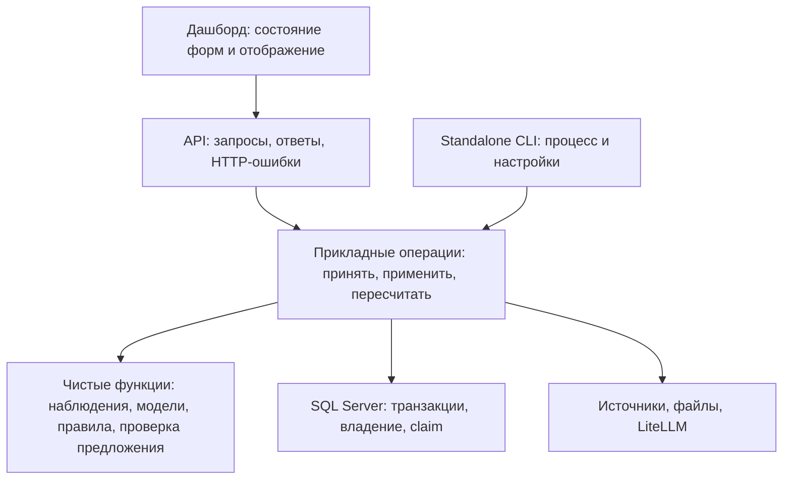

# План повышения корректности и упрощения corV2

Дата: 11.11.2026. **Утверждён пользователем: выполнить все этапы 0–5.** Основание: [senior-review-2026-11-11.md](senior-review-2026-11-11.md). Исходный коммит: `39cd71e`.

## Цель

Корректные расчёты и данные, минимальный необходимый production-код, понятные границы ответственности при сохранении всех функций демо: приём источников и документов, история, НТЦ и модель вероятности, CO₂-сценарии/импорт, рейтинг, предложения агента, расписание, дашборд, Excel, Windows CLI и локальная/GitHub-сборка.

Приоритет: сначала исправить проверяемые нарушения, затем уменьшать дублирование на зелёных тестах. Сокращение строк оценивается вместе с числом ветвей, повторных проходов, SQL-запросов и затратой на сопровождение. Новый код проверок может увеличить общий LOC, одновременно уменьшая production-код и вероятность ошибок.

## Предлагаемые границы

Это границы зависимостей, а не требование создать по пакету и классу для каждого блока. Переиспользовать существующие модули; выделять функцию/модуль, когда это удаляет дублирование или даёт ясную тестируемую границу. Численные функции не обращаются к БД/LLM. Прикладные операции явно определяют транзакцию. API не содержит собственную версию бизнес-правил. UI хранит черновик отдельно от результата запроса.

## Этап 0. Контракт и тесты до исправлений

Уже сделано:

- исходный полный набор: 94 passed;
- новые регрессионные проверки написаны до изменения приложения;
- все 16 новых проверок воспроизвели ожидаемые дефекты;
- защищены данные рабочей системы: тесты используют отдельную временную SQL Server.

После подтверждения, до соответствующих изменений:

- добавить положительные и граничные примеры к текущим красным тестам: правильная бригада, `85% → 0.85`, реальный достаточный тренд, валидный baseline;
- добавить проверки отката транзакции между удалением/вставками и смены ID скважины при reprocess;
- добавить тест восстановления старого задания, исключающий повторный claim активного;
- зафиксировать поведение рангов при равных оценках и API/Excel для существующих демоданных;
- подготовить браузерные проверки черновика CO₂, импорта, смены скважины и устаревшего ответа;
- проверить setup/env round trip и поведение CLI start/status/stop/restart через системную границу.

Для каждой новой проверки сначала показать, что она падает по нужной причине либо фиксирует уже корректный контракт. После этого менять приложение.

## Этап 1. Сохранность документов и подтверждение данных

Замечания: **R01, R02, R03, R08**.

1. Разделить извлечение/валидацию документа и применение его результата.
2. Применять новую версию атомарно; не удалять старую версию при ошибке OCR/LLM, неверном формате или сбое записи.
3. Явно различать независимый импорт и вклад документа; обеспечить корректность удаления одинаковых файлов, загруженных разными путями.
4. Проверять число по единице конкретного поля и полярность булевой цитаты.
5. Заменить безусловный reset на атомарные переходы состояния с проверкой claim.
6. Пересчитывать все затронутые старые и новые скважины после успешной записи; определить восстановление при сбое пересчёта.

**Выход:** исходные данные сохраняются при любом неуспешном reprocess; удаление документа не удаляет чужой вклад; один активный обработчик; неверные числа/булевы факты не загружаются.

**Миграция:** перед изменением схемы — резервная копия и прогон на копии старой БД. Для старых batch с неоднозначным владельцем выбрать консервативное сохранение данных; не объявлять происхождение восстановленным без доказательств. Уже потерянные данные автоматически не восстанавливаются — при необходимости нужен исходный файл/резервная копия.

## Этап 2. Единая семантика наблюдений и рейтинга

Замечания: **R04–R07, R15**.

1. Сохранять источник/время значения на уровне поля; не назначать всем данным строки лабораторный срок актуальности.
2. Использовать небольшой общий механизм отбора реальных наблюдений для трендов, устойчивости и полноты данных.
3. Отличать текущий срез с переносами от доказательств из настоящих измерений.
4. Не подтверждать защиту при неизвестном обязательном отклонении закачки; сохранять исходный индекс без скидки до подтверждения.
5. Проверять baseline и остальные параметры модели на конечность, порядок и допустимые границы.
6. Заменить повторный подсчёт ранга одним проходом по отсортированным оценкам; сохранить поведение равных мест.

**Выход:** показатели и пояснения согласованы, расчёт не зависит от частоты посторонних измерений, искусственно заполненные точки не увеличивают доказательную базу. Отдельно описать ожидаемые изменения рейтинга именно из-за исправленных ошибок.

## Этап 3. Ограничения предложений и обновление расписания

Замечания: **R09–R11**.

1. Проверять бригаду и дату серверным кодом, независимо от послушности LLM.
2. Различать пустое расписание и ошибочную загрузку; разрешить очистку прежнего расписания корректным пустым срезом.
3. Упростить дедупликацию пробелов так, чтобы сохранять дополнительные недостающие показатели.
4. Убрать повторные классификации источников: небольшой публичный каталог вместо импорта приватного `_Sources` из сборщика рейтинга.

**Выход:** занятая/недоступная бригада не попадает в предложение, старое расписание корректно заменяется, сведения о пропусках не исчезают. Остальные возможности агента, включая отличающееся от рейтинга обоснованное предложение, сохраняются.

## Этап 4. API и дашборд с меньшим количеством повторных действий

Замечание **R14** и архитектурные улучшения.

1. Хранить CO₂-черновики и незавершённые запросы по скважине; автоматическое обновление не пересоздаёт активную форму.
2. Отделить обновление результата от состояния ввода; отклонять устаревшие ответы после смены скважины.
3. Использовать один механизм запросов/ошибок, убрать локальные дубли там, где поведение совпадает.
4. Убрать синхронный parsing/SQL из event loop CO₂-import, переиспользуя подход существующего импорта документов/Excel.
5. Пакетировать чтение ID/вставки CO₂; сохранить идемпотентность и атомарное подтверждение импорта.
6. Разделить большой JS-файл на небольшое число модулей по состоянию и ответственности, только если это уменьшает сложность; оставить текущую поставку без обязательной frontend-сборки.

**Выход:** тесты браузерных сценариев проходят; ввод сохраняется через автообновление; API остаётся отзывчивым при импорте; число SQL-запросов на пачку измерено до/после.

## Этап 5. Standalone и единая проверенная поставка

Замечания **R12, R13**.

1. Проверять идентичность экземпляра перед остановкой процесса, включая время создания и приложение/runtime.
2. Возвращать ошибку CLI при неуспешном старте/остановке, не выдавать успех по одному PID.
3. Сделать ошибки компиляции, DLL и манифеста фатальными для сборки до публикации архива.
4. Расширить Windows smoke проверкой standalone CLI, а не только импорта API и CO₂.
5. Свести локальную и CI-сборку к одному проверенному пути; разовый release_co2_demo.sh заменить обычным воспроизводимым процессом выпуска после сохранения нужных проверок.
6. Собрать локальный и GitHub-архивы одного итогового коммита, сверить манифест, состав и SHA-256 каждого, сохранить возможность отката.

**Выход:** полные тесты зелёные, прикладные сценарии пройдены, Windows start/check/status/stop/restart подтверждены, оба архива проверены. Мерж и рабочее развёртывание согласовываются отдельно при необходимости.

## Правила минимизации и сохранения функциональности

- Небольшие тематические коммиты: тесты → исправление → локальное упрощение. Каждая правка имеет наблюдаемую причину и критерий готовности.
- Удалять дублирующие пути применения данных, эвристики с потерей информации и повторные проходы. Не добавлять generic repository/service/base-class и другие слои без конкретной потребности.
- Сохранять действующие API, настройки, форматы источников и Windows-команды; изменение контракта явно документировать и проверять совместимость.
- Менять численные результаты только для подтверждённой ошибки или согласованного правила; остальные результаты контролировать тестами.
- Проверки происхождения и допустимости — часть функциональности. Их сохранность важнее снижения LOC.
- Не переобучать модель и не выдавать синтетические данные за полевую валидацию в рамках этого плана. Базовый CO₂-пересчёт и импорт A1/A2 сохраняются в согласованных границах.

## Приёмка после разработки

1. Все исходные 94 и 16 регрессионных тестов проходят; дополнительные граничные/приёмочные тесты также зелёные. Никаких скрывающих дефект skip/xfail или ослабления assert.
2. Проверены оба SQL-драйвера в доступных окружениях либо явно записано, какой драйвер проверить не удалось.
3. Пройдены миграция копии старой БД, повторный импорт, reprocess с отказом, конкурентный claim и удаление документа.
4. Продукт проверен по цепочке: загрузка → данные/происхождение → рейтинг/объяснение → предложение → карточка/Excel → CO₂-расчёт/история.
5. Браузерные проверки сохранения ввода и обновления выполнены на работающем приложении; WinAPI unit mock не заменяет проверку CLI на Windows.
6. Локальная и GitHub-поставки связаны с одним коммитом. Фиксируется SHA-256 каждого архива; одинаковость ZIP побайтно не заявляется без воспроизводимой упаковки.
7. Итоговый отчёт: что удалено/упрощено, какие результаты исправлены, какие функции сохранены, результаты тестов и оставшиеся ограничения.

## Утверждённые решения

Пользователь утвердил **все этапы 0–5**, включая структурные улучшения API/JS и общий каталог источников.

Предлагаемые правила, входящие в подтверждение:

- неизвестное обязательное отклонение закачки → защита не подтверждена, скидка риска не применяется;
- семидневная устойчивость → семь последовательных календарных дат в согласованном часовом поясе источника;
- явно доступная бригада допускается только при корректной дате назначения; заданные границы окна и крайний срок обязательны. Отсутствующие границы окна считать открытыми для совместимости существующего формата; неизвестный/занятый статус не разрешает назначение;
- неоднозначная цитата не подтверждает факт; старый подтверждённый вклад документа сохраняется при отказе новой обработки.

Итоги реализации и проверки фиксируются отдельно в `upgrade-results-2026-11-12.md`; это исходный утверждённый план.
